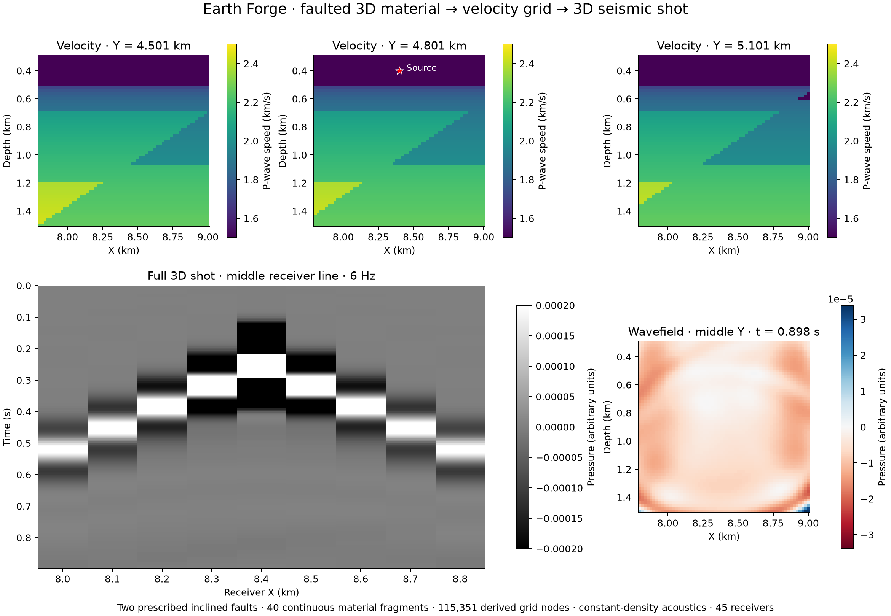
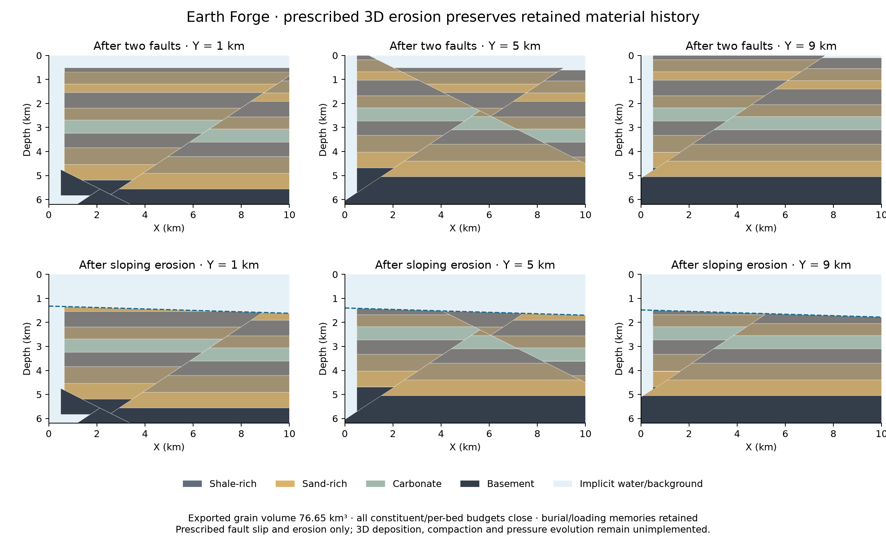

# Earth Forge

A sedimentary-basin simulator that generates candidate subsurface velocity
models from geological history. Earth Forge builds sections step by step,
then applies rock-physics relationships to the simulated burial history.
Numerical benchmarks and geological reference comparisons are included.
Accuracy against independent field data has not yet been established.

Earth Forge is open source under the [MIT license](LICENSE). Third-party
components retain their own licenses and bundled notices.

Try the public web alpha: [2D sections](https://arthifact.github.io/earthforge/)
or the [3D basin viewer](https://arthifact.github.io/earthforge/3d.html).

[Alpha release and installers](https://github.com/arthifact/earthforge/releases/tag/v0.2.0-alpha.1)
· [Reproduce the research workflow](examples/research/README.md)
· [Automated checks](https://github.com/arthifact/earthforge/actions/workflows/research.yml)

**Research alpha 0.2.0a1:** [Python and CLI quickstart](python/README.md),
[release evidence and remaining SOTA gates](docs/research-release.md). The app
now shares three versioned scenario families with the research API. Batch
ensembles, well/horizon likelihoods, exact tiled f64 exports and paired seismic
artifacts are available through the source and alpha installers; independent
field validity remains open.

Earth Forge will grow through small open-source and web releases. The first
public alpha will expose the supported workflows with examples and their
physical assumptions; independent field validation continues alongside later
releases. See the [release plan](docs/releases.md),
[changelog](CHANGELOG.md) and [contributing guide](CONTRIBUTING.md).

The aim is a generator anyone can set up for where they are:

- **A geologist** says "this kind of basin, this history, these facts".
- **A seismologist or tomographer** may know no geology at all, only a few
  surface shots.

The planned workflow will let users answer "don't know" and use observations
to narrow the range, for example by rejecting models whose first arrivals
do not match picked times. The research API currently weights finite model
libraries against well velocities, surfaces, basement and horizons;
first-arrival conditioning remains planned. The current outputs are synthetic sections and an explorable 3D basin with velocity,
lithology, strata and faults.

The intended uses are candidate priors for full-waveform inversion (FWI),
training data and synthetic test models. Suitability for any of these uses
needs validation in the target setting.

## Rust migration (2026-10-17)

The browser simulation worker now runs `earthforge-core` in WebAssembly.
The same crate builds a native command-line engine for batch studies. Rust
owns the event sequence, compaction, erosion, deposition, normal and thrust
transport, material memory, conservation budgets and velocity projection.
TypeScript owns the page, messages and validation measurements. Browser builds
include portable and SIMD modules for both page previews and deterministic
research. Research requests default to shared Rust scalar math; routine page
previews opt into host scalar primitives. The loader falls back within the
selected profile when SIMD cannot be fetched or compiled. The original
TypeScript simulator remains a reference for migration comparisons.

The original basin-history generator produces **2D sections**. A new integrated
**3D basin** mode adds deposition, differential subsidence, oblique fault
transport, erosion/reburial, vertical compaction and spatial burial/loading
memory. Open `3d.html` or the **3D basin** link in the app. The viewer now renders
the full sampled block, with rotation, clipping, a corner cutaway and movable
orthogonal planes. The detailed recipe adds growth strata and migrating facies;
see the block-viewer measurements below. The core uses explicit
world-space x/y/z coordinates and independent grid spacings. The earlier
continuous-geometry prototypes remain available:

- `volume::ColumnField` shares a background column across uniform regions and
  supports grid-aligned motion across horizontal faults. Unsupported geometry
  returns an error.
- `volume3d::MaterialVolume` stores layered material as continuous convex
  polyhedra. It splits supports at inclined planes, applies tangential slip in
  x/y/z, clips open boundaries, erodes prescribed sloping surfaces, and returns
  requested cross-sections. Material
  identity, sand fraction and burial/loading memory travel with each support.
  Its cost follows the number of material interfaces and fault fragments,
  rather than a dense voxel count. It is a prescribed-kinematics prototype;
  curved faults, 3D compaction/pressure evolution and force-driven deformation
  are not implemented.

The migration preserves the existing physical laws and coefficients. It does
not establish SOTA accuracy or independent geological validity. Historical
migration reports remain in `validation/rust/`; corrected native and 3D
validation is saved in `validation/overnight/`:

- `canonical-numerics-results.json`: all 36 frozen 40/20/10 m runs close, with
  4,494 passing event budgets and unchanged eligibility rules and tolerances.
- `canonical-acceptance-results.json`: all 14 required numerical, conservation
  and physical gates pass. Geological screening remains separate.
- `native-math-parity-20m.json`: extension, coupled compression and exhumed
  extension match the TypeScript reference in displayed velocities, bed labels
  and total grain inventory, in native Rust and WebAssembly.
- `math-compatibility-results.json`: 120,054 bitwise native/host scalar math
  comparisons pass on Node 24.18 / V8 13.6, within the stated input domains.
- `allocation-numerics-results.json` and `allocation-numerics-equivalence.json`:
  the optimized engine retains identical recorded cases, grain budgets and
  refinement metrics on all 36 frozen runs.
- `volume3d-validation.json`: a 10 × 10 × 6.2 km volume with two inclined,
  oblique faults uses 40 material fragments, closes every constituent/per-bed
  grain budget and produces bit-identical native/Wasm geometry and sections.

The previous checkpoint's 52 Rust tests include independent analytical clipping integrals, 4,000
inverse-map occupancy checks, crossline reduction, oblique along-strike
variation, repeated faults and 20,000 independently back-traced points after four
different oblique faults, with no overlapping material. They also retain exact thin-layer arithmetic,
independent flow quadrature, 150 transport problems checked by exhaustive
search, conservation, repeatability and parallel compaction. At that checkpoint,
all 202 tests in the 31-file legacy TypeScript regression suite passed, run with
two concurrent files. That full suite has not been rerun for the integrated 3D
history addition. The historical result and module/source hashes are saved in
`validation/overnight/final-legacy-results.json`; the earlier 200-test checkpoint
is retained separately. The block-viewer checkpoint passed 79 Rust tests. The current research alpha
passes 85 Rust tests, 26 Python checks (including an independent VTK reader),
ten focused worker/loader/view geometry checks, native and Wasm
Clippy checks, TypeScript checking and the production build. The focused checks
cover deterministic math, view-only sampling, bounded replay caching, transferred
buffer ownership, clipping/picking geometry and error recovery. The history
checkpoint's eight tests check swept faults, advected facies, pruning, detailed
histories and orthogonal sections. Six research-release tests add exact global
windows, material-state projections, contact queries and capability checks.
The legacy full TypeScript suite was not
rerun for this addition; the shared material laws and the 2D engine are unchanged.

The initial native compression discrepancy is resolved on the saved fixtures.
JSON parsing preserves binary64 input values. Native and deterministic Wasm
use a versioned V8/FDLIBM adaptation with explicit fused operations, with source
and notices in `crates/earthforge-core/src/native_math.rs` and
`crates/earthforge-core/licenses/V8.txt`. An expanded sweep exposed
five sine-tail differences caused by an extra fusion; correcting that evaluation
passes the original 120,054-input gate and 2,520,084 expanded comparisons against
Node 24.18, with native hardware and scalar/SIMD software arithmetic. These are
tested inputs, not a universal compatibility claim for every binary64 argument
or future JavaScript runtime. Large trigonometric arguments outside the basin
domain use pinned `libm`.

Standard Wasm software FMA is slower on full geological histories. Measured
exact-value caches did not help, and an interval-filtered FMA, despite passing
independent native/Wasm checks, was slower still; those experiments remain in
`validation/overnight/experiments/` and the frozen-engine archive. They are not
production optimizations. Page previews retain fast host scalar primitives,
while research calls use the same routines as native Rust. Simulation control
and material state stay in Rust in both profiles. No precision or physics
coefficient changes are used to obtain the performance results.

The initial migration timings mixed all engines in one process and retained
large diagnostic states. They are unsuitable for a performance conclusion.
`validation/overnight/benchmark.mjs` measures each engine in a separate process,
with warmup, repeated trials and matching physical-output hashes. See its
saved results for local end-to-end timings and exact measurement boundaries.
In the saved isolated 40/20 m extension/compression cases on an Apple M4 Pro,
the exact-arithmetic allocation fast paths reduce native median times by
19–33% and Wasm median times by 4–22%, with identical physical-output hashes.
Native end-to-end times are 2.3–3.2 times faster than the TypeScript reference.
Wasm is faster on compression and slower on extension; a general browser
speedup is not established. The fast paths retain arbitrary-precision fallback
and pass independent unbounded-integer comparisons. Worker memory snapshots
are not peak-memory measurements or native child-process RSS.
These measurements do not compare Earth Forge with another research system.

### Research guiding the 3D design

- [OpenVDB](https://www.openvdb.org/documentation/doxygen/overview.html): separate
  world and index space, share uniform regions and avoid a dense volume as the
  authoritative material state. These principles informed the column-field
  prototype; Earth Forge does not depend on OpenVDB.
- [CGAL volume clipping](https://doc.cgal.org/latest/PMP_Boolean_operations/group__PMP__clip__grp.html):
  closed supports need a cap at each cut. Earth Forge's own convex clipping
  implementation is tested against analytical volumes; it uses binary64
  geometry, rather than exact geometric predicates, and does not depend on CGAL.
- [Vertex Block Descent](https://arxiv.org/abs/2403.06321) and Cem Yuksel's
  [Augmented VBD](https://www.cemyuksel.com/research/papers/Augmented_VBD-SIGGRAPH25_RTL.pdf):
  local updates and parallel constraint solving are useful references for a
  future stress/contact solver. These methods address elastic dynamics and
  contact; real-time stability alone does not validate geological deformation.
  Neither solver is implemented here.
- [MLS-MPM and CPIC](https://github.com/yuanming-hu/taichi_mpm): references for
  future large-deformation transport and discontinuities. A conservative
  benchmark should establish acceptable transfer error and cost before adopting
  such a solver. MPM is not implemented here.
- [SubsurfaceGen](https://arxiv.org/html/2605.30541v1) provides a concrete
  capability comparison: full 3D procedural models, broader geological
  modules and paired seismic data computed from 2D slices. Earth Forge now has integrated 3D history and a scoped, common-field
  execution control. Broader geology and independent comparison evidence are
  still required before any claim of superiority; a handful of synthetic shots is not a
  matched training or inversion benchmark.

The integrated history mode below implements supported deposition and vertical
compaction through continuous regional ray queries, with spatial burial/loading
histories and independent reduction/convergence tests. The polyhedral prototype
retains its explicit geometric inventories and clipping tests. General stress
equilibrium, fluid flow and complex fault mechanics remain separate modelling
work. The reserved FORCE holdout has not been read or scored.

### Shared physics for 2D and 3D

Both production paths use one Rust material-physics core. `physics.rs` defines
porosity, effective loading and seismic velocity. `material.rs` owns `Layer`,
exact layer arithmetic, deposition subdivision, the compaction solve and
irreversible burial/loading updates. The original 2D deposition entry point
keeps its 10 m subdivision; the 3D adapter supplies its configured material step
to that same implementation. Both adapters call the same guarded compaction
kernel, including the original 36 rounded bisection decisions.

Geometry and event orchestration remain dimension-specific: the existing 2D
basin uses conservative section transport and finite-column boundary bookkeeping;
`history3d` uses regional inverse fault maps and open observation windows. Those
wrappers define where material moves and how depth/boundaries are represented;
they do not contain separate depositional or compaction laws. The 3D path retains
internal water explicitly. A seed does not specify an identical history across
the two different scenario generators. The acoustic solver already shares its
physical model across 2D and 3D grids.

The original TypeScript implementation remains a frozen migration reference;
production simulation runs in Rust. Future changes to the shared material laws
belong in this common core with both geometry adapters checked. An independent
frozen bisection oracle still checks 20,000 varied columns so comparing the two
wrappers cannot accidentally become a self-comparison. Whole-response regression
against the pre-consolidation engine is recorded in `validation/unified-material/`.
The performance series below predates this extraction; its frozen module hashes
identify that measured version. Output equivalence does not establish a new
performance measurement.

### Integrated 3D geological histories

`kind:"history3d"` defines a continuous regional material model by ordered events.
After oblique fault slip, a vertical query retrieves material from different
earlier x/y locations through the inverse fault map. Subsequent deposition,
erosion and compaction operate on that transported material. The result is one
coherent 3D history, rather than independently generated sections or an extrusion
of a final 2D image. Output sections and nodal grids are derived queries; changing
their sampling does not change the material state.

Each ray retains exact binary interval ownership, bed identity, grain thickness,
composition and irreversible burial/effective-loading memories. Compaction uses
the existing drained porosity law and keeps grain thickness fixed while changing
bulk thickness. Its vertical material subdivision is controlled by `materialStep`
(10 m by default), independently of output sampling. Within each stratum the
constitutive state uses a midpoint approximation. Independent integrated
deposition and compaction cases test convergence at 20/10/5 m subdivisions; this
does not establish convergence or geological accuracy for every 3D history.

Water above and basement below each finite profile are specified regional tails.
Regional spatial fields and all events also define material outside the visible
box, so fault boundary inflow has an explicit source. Internal water intervals
are retained, not packed away. The displayed box is an **open observation window**.
Local per-bed deposition/erosion/compaction budgets are checked separately from
global inventory quadrature. Optional `inventoryCells:[nx,ny]` reports midpoint
integrals at that resolution and twice that resolution, with an error indicator.
It does not claim exact closed-box conservation or a certified quadrature bound.
An independent padded/polyhedral fault example checks those integrals against
continuously clipped 3D volumes.

The classic generated history includes lateral variations in subsidence, deposition and
facies, normal or reverse planar faults, optional prescribed overpressure, and
optional erosion followed by reburial. Compaction is quasistatic and vertical;
pressure and fault motion are prescribed. It does not solve 3D stress equilibrium,
fluid-flow evolution, gravitational collapse, curved-fault mechanics or salt
dynamics. These assumptions are visible in the app and the response metadata.
Independent field accuracy and SOTA superiority remain unestablished.

```json
{"kind":"history3d","options":{"seed":20261014,"steps":12,"faults":2,"compaction":true,"materialStep":10},"query":{"nx":61,"nz":81,"sectionsY":[1000,5000,9000]}}
```

An explicit `model` replaces the seeded recipe: `bounds`, `initialSurface`,
`initialLayers`, `beds`, `events`, `materialStep` and optional replay `stages`.
Event types are `subsidence`, `deposit`, `fault`, `sweptFault`, `erosion`,
`pressure` and `compact`. Spatial fields have `value`, `slopeX`, `slopeY`, optional
sinusoidal `waves` and optional tanh `fronts`. Deposition uses a thickness or fill surface with an optional supply cap.
`query.stage` selects a coherent history prefix; `query.rays` with
`includeProfiles:true` exposes carried material; `query.points` provides exact
ownership queries; `query.grid` derives velocities for the existing 3D acoustic
solver. `query.planes` requests orthogonal continuous-model sections, including
the exact coordinates used for evaluation. `includeMaterial:true` adds material
fields to the sampled volume. The app exports the explicit model, query, view
and display fingerprint; the full field can be reproduced from that request.

Validation and the frozen performance requests are in `validation/history3d/`.
The initial deterministic browser path exposed redundant constitutive and
point-ownership work. The compaction optimization contracts a guarded monotone
root bracket, then replays the original 36 rounded bisection midpoints; ambiguous
comparisons still evaluate the constitutive law. It matches the existing solver
bit for bit on 20,000 varied columns. Derived sampling caches ray interfaces and
falls back to exact ownership near rounded boundaries. Conservative regional
envelopes prune fault branches only when the cut cannot intersect either
possible finite material profile; an independent unpruned path checks this
optimization, including queries beyond the regional halo. These optimizations
change no physical coefficients, material detail or numerical tolerances.

Native queries run independent, ordered batches through Rayon. Browser builds
use the same Rust model without a GPU requirement; the app uses deterministic
research math. Replay caches are labelled with their original calculation time.
Performance reports measure actual model evaluation and sampled output, not
only camera rendering or replay lookup. A small set of sections is a different
workload from a full dense 3D export or seismic survey, and no speed comparison
with the original 2D generator or SubsurfaceGen is established by these timings.


Historical classic-recipe measurements, before the full block viewer: measured
on an Apple M4 Pro with one warmup and three fresh-process trials per
case/profile, fixed 10 m material subdivision and three 61 × 81 sections across
the same 10 × 10 × 6.2 km regional observation window:

| History | Native median | Deterministic Wasm median |
| --- | ---: | ---: |
| 6 steps, 1 fault | 14 ms | 211 ms |
| 12 steps, 2 faults | 34 ms | 849 ms |
| 18 steps, 3 faults | 76 ms | 2.06 s |
| 24 steps, 4 faults | 182 ms | 4.23 s |

These include request/result handling and decoding; Wasm initialization is
reported separately. Native includes CLI startup. Our controlled builds,
tests and browser calculations were stopped during these measurements. See
[scaling measurements](validation/history3d/scaling-benchmark.json). The separate
four-case [optimization comparison](validation/history3d/final-performance-equivalence.json)
records unchanged physical hashes in all 12 case/profile pairs and approximately
4–5× gains over the accepted initial implementation. It is an internal version
comparison. Fresh-process native peak RSS is 17.4 MB for 12 steps/two faults and
33.6 MB for 24 steps/four faults, including CLI/JSON work; see
[memory measurements](validation/history3d/memory-results.json). No power or
energy measurements were made.

In that earlier three-section viewer, a Chromium cold calculation took 819 ms. Its exported
explicit model and displayed query reproduce every displayed velocity, bed,
lithology and surface/basement value exactly in the native engine
([export check](validation/history3d/browser-export-validation.json)). This is
an app diagnostic, separate from the controlled timing series. Twenty replay
cases across four histories, a derived 3D grid and its 3D acoustic shot match
exactly across native and all four Wasm builds; all four original canonical
native acoustic shots remain unchanged
([validation results](validation/history3d/validation-results.json)). These
results support an interactive default workflow, not universal real-time 3D
physics or a demonstrated SOTA claim.

A separate coarse full-window export samples 33 × 33 × 65 nodes over the entire
10 × 10 × 6.2 km window. All 70,785 velocity/material samples match exactly
between native and deterministic SIMD Wasm. One diagnostic run took 147 ms and
4.66 s respectively; this is not a controlled timing series. Output spacings
are 312.5/312.5/96.875 m while the material subdivision remains 10 m. This coarse
output grid is not validated for wave propagation
([full-window check](validation/history3d/full-window-results.json)).

### Full 3D block viewer and detailed recipe (2026-10-17)

The app defaults to `options.geology:"detailed"`. The API default remains
`"classic"`, preserving old seeded models exactly. Detailed cycles contain 3–7
sub-beds with finite sediment supply and accommodation-limited deposition,
migrating tanh facies fronts, differential subsidence, prescribed wave-base
erosion and repeated fault-slip episodes with deposition between them. Seed
908054 at 12 cycles/two faults prescribes 69 depositional beds. Both recipes
reuse the existing material, porosity, pressure and velocity laws.

A swept fault bends **along strike**, using the shear map
`W(x,y,z)=(x-a(y),y,z)` around a planar tangential slip. Its continuum Jacobian
determinant is one. The inverse map transports bed composition and material
memory from the source location. It does not simulate dip curvature, elastic or
plastic force balance, pore-fluid flow or salt dynamics. Compaction remains
vertical, quasistatic and drained, with the same 10 m midpoint material
subdivision. Synthetic verification does not establish field accuracy or SOTA.

Rotation, zoom, X/Y clipping, peeling, the corner cutaway, three movable planes,
colour changes and picking operate locally on the sampled volume. They never
rerun the history. WebGL2 uses nearest-node material ownership and draws only on
interaction or resize. A software raycaster is available without WebGL2
(`?software=1`). GPU textures and f32 viewer buffers are display encodings;
Rust evaluates the source model in f64. Thin beds can be missed by block sampling.
**Refine this section** queries the continuous history at 20 m horizontal/10 m
vertical spacing for X/Y planes, independently of block sampling. The returned
coordinates are explicit; this does not refine the physical material state.

The viewer supports full block, corner cutaway and orthogonal sections, true
proportions or explicit 2×/3× vertical display, water display, pointer/keyboard
camera controls, bounded replay caching and reproducible JSON export. Replay
cache times retain their original calculation labels. Export includes the
source model, exact request, view, SHA-256 of the typed display buffers and any
separate view-performance measurement. A new model invalidates old view timings.

On this Apple M4 Pro, isolated serial runs used one warmup and three measured
complete queries per case/engine. Both engines use deterministic research math,
fixed seed 908054 and 10 m material subdivision. All repeated projection hashes
and native/Wasm pairs match exactly:

| Detailed history / display | Samples | Native median | Deterministic SIMD Wasm median |
| --- | ---: | ---: | ---: |
| 12 cycles, 2 faults / Quick | 175,329 | 0.196 s | 2.973 s |
| 12 cycles, 2 faults / Standard | 578,641 | 0.450 s | 6.648 s |
| 12 cycles, 2 faults / Fine | 2,032,225 | 0.967 s | 12.228 s |
| 24 cycles, 4 faults / Quick | 175,329 | 1.619 s | 34.067 s |

Native includes fresh CLI startup and result decoding; Wasm setup is separate
and each case reuses its compiled module for its trials. These are fresh model
queries, not cached replay or camera draws. See
[requests, trials and hashes](validation/block-viewer/benchmark-results.json).
Native peak process RSS medians are 254 MB (Standard), 632 MB (Fine) and 281 MB
(long history/Quick), including response serialization. Wasm linear memory is
reported separately in the timing records; neither is browser process memory.
See [memory measurements](validation/block-viewer/memory-results.json).
No energy or power measurements were made.

A Chromium camera sweep on the already sampled Standard block measured
120 fps, 0.10 ms median CPU submission, 0.30 ms p95 CPU submission and 0.95 ms
median GPU time at 878 × 432 interaction pixels. The block-evaluation counter
stayed at one. These are local rendering measurements, not real-time geological
evolution or a universal device guarantee. The browser's 6.50 s initial model
query and exported display fingerprint reproduce exactly in native Rust; the
continuous Y section sampled 501 × 301 values in 1.34 s. See
[browser export and rendering check](validation/block-viewer/browser-export-validation.json).

All 79 Rust tests pass, including 4,001 independent swept-fault occupancy checks,
501 numerical Jacobian/inverse checks, 2,001 advected-facies checks and exact
pruned/unpruned material histories. Six detailed replay cases match exactly
between native and all four Wasm modules and the frozen pre-pruning engine;
so does a detailed-volume 3D acoustic shot. Twenty classic replay cases, their
volume/shot and four original acoustic fixtures retain exact results. The only
new physical optimization tightens a conservative fill-surface bound using
`top' = max(min(top,fill),top-cap)`; no precision, coefficient, material detail
or numerical tolerance was changed. See [detailed validation](validation/block-viewer/validation-results.json)
and [classic regression](validation/block-viewer/classic-regression.json).

### Acoustic forward modelling

`acoustic` adds an independently implemented constant-density isotropic wave
solver for **2D and 3D** velocity grids. It uses fourth-order centred spatial
differences, second-order centred time, bilinear/trilinear source/receiver
weights and a quadratic absorbing sponge. The CFL bound follows the actual
stencil and grid spacings. Only three wavefields rotate through memory;
receiver traces are stored, rather than a complete time-volume array. The
geological material representation and the acoustic grid remain distinct.
The PDE formulation is described in the
[Devito modelling tutorial](https://www.devitoproject.org/examples/seismic/tutorials/01_modelling.html);
Earth Forge does not depend on Devito.

The eight acoustic checks cover an analytic travelling wave with expected
refinement rates, exact uniform-crossline reduction, 3D arrival times,
constant-density interface reflection, heterogeneous source/receiver
reciprocity, absorbing-boundary error against a larger-domain reference,
repeatability, invalid acquisition/CFL rejection, and rejection of nonfinite
updates before rotating wavefield state, and bit-identical native updates
across one, two and four threads. Saved results are in
`validation/overnight/acoustic-analytic-validation.json`.

```sh
node validation/overnight/acoustic-checks.mjs
node validation/overnight/acoustic-demo.mjs
```

The demo produces two generated 2D basin velocity/shot pairs (229 receivers,
40 m receiver spacing, 6 Hz source, 3.2 s recording) and an analytic layered 3D
pair. All native/Wasm shot samples, final fields and diagnostics match bit for
bit. Compact provenance is in `seismic-pairs-summary.json`; reproducible raw
pairs are written under ignored `data/seismic/overnight-v1/`. The JSON API takes
`kind:"acoustic"`, `grid`, `velocity`, `source`, `receivers`, `frequencyHz` and
`durationSeconds`, with optional `dtSeconds`, `sourceDelaySeconds`,
`spongeCells` and `includeFinalField`. Grid values are nodal, x fastest then y
then z, in metres and m/s; `ny:1` selects a 2D x/z plane. Source and receiver
coordinates share the grid's world frame. Output traces are receiver-major.

These are synthetic constant-density pressure data with a unit Ricker source,
normalized by cell area/volume. Absolute amplitudes are not field-calibrated.
Elastic waves, anisotropy, intrinsic attenuation, a free surface, PML,
migration and field calibration remain future work. The 3D layered acoustic
example is not a geological-history model.

Independent double-precision Devito 4.8.23 comparisons cover homogeneous,
layered and smooth 2D media plus homogeneous/layered 3D media, anisotropic grid
spacings, nonzero world origins and off-grid source/receiver coordinates.
All five comparisons meet the predeclared thresholds after aligning the
symbolic coefficient precision to 17 digits, with relative field/trace L2
errors below 1e-13. The installed Devito version uses nine-digit derivative
coefficients by default; that default comparison has errors up to 2.1e-8 and
falls just outside the stricter L2 threshold. Both results are retained.
`compare_devito.py` applies an explicit in-memory precision override, without
editing the installed package or copying Earth Forge's stencil. Matching zero
halos are used in both codes; this does not cross-check sponge boundaries.
See `devito-comparison-summary.json` and the two precision-specific reports.
Optional Python reference/plot dependencies are pinned in
`validation/overnight/reference-requirements.txt`.

```sh
DEVITO_ARCH=clang DEVITO_LANGUAGE=C DEVITO_SAFE_MATH=1 \
  EARTHFORGE_DEVITO_COEFFICIENT_DIGITS=17 \
  python validation/overnight/compare_devito.py
node validation/overnight/acoustic-green3d.mjs
```

The separate continuum 3D Green-function check validates source normalization,
absolute amplitudes and waveforms along three directions. At 20/10/5 m grid
spacing, the worst relative waveform L2 error decreases from 2.43% to 0.62%
to 0.17%, before reflected wavefronts can reach the receivers. This is numerical
verification of the stated acoustic model, rather than field validation.

Two isolated wave-kernel experiments preserve every saved output hash. First,
defer only the finite-value error reduction: native end-to-end time falls by
32–43%, scalar Wasm by 7–9% for 3D shots and 48% for 2D shots. Second, express
stencils as disjoint row slices so bounds are established before the inner
loop, retaining exactly the same arithmetic and error behavior. Against the
first optimization, this improves native 3D times by 2.4–3.0 times and portable
Wasm by 3.5 times. SIMD now becomes useful: the SIMD row kernel is 5.6–5.7 times
faster than the first portable optimization in the two 3D examples.
`kernel-benchmark-results.json` and `row-benchmark-results.json` retain warmups,
all trials, hardware, measurement boundaries and binary/output hashes.
These compare Earth Forge versions without establishing a speed advantage
against another research system. No relaxed SIMD or fast-math is enabled.

A separate full-history measurement checks for regressions from enabling SIMD
outside acoustics. Extension and compression at 40 m have identical physical
hashes and median times within 1% between the two modules; see
`wasm-selection-benchmark-results.json`. Three full 20 m history fixtures also
match native Rust, SIMD Wasm and the TypeScript reference exactly in displayed
velocity, labels and total grains. Their mixed-process timings are diagnostic,
not controlled performance measurements (`row-simd-parity-20m.json`). The earlier host-math browser diagnostic is retained. Deterministic research
modules remove that cross-runtime drift on the validated examples, including
exact native/browser projected velocities and full pressure arrays.

Native 3D wavefields with at least 262,144 active padded cells use independent
plane updates through Rayon; 2D and smaller grids stay serial. The field reads
are immutable, output planes are disjoint and the only cross-plane reduction
is a boolean error flag. Source injection and buffer rotation follow completion
of every update. The same row arithmetic is retained, with no floating-point
sum reordered across threads. A separate 12-measurement comparison records
one/two/four/eight/default thread configurations. The two saved 3D shots take
63 and 92 ms end to end on this Apple M4 Pro, versus 305 and 477 ms for the
serial row implementation (4.9–5.3 times faster), with identical output hashes.
These are small prototype shots, including CLI request/response and decoding;
they are not full-domain 10 m simulations or energy/power measurements.
`RAYON_NUM_THREADS` controls the native thread budget. See
`parallel-benchmark-results.json` and `parallel-native-validation.json`.

The final isolated profile check (`final-profile-benchmark-results.json`)
records 303/432 ms for the deterministic Wasm 3D shots and 304/431 ms for the
preview modules. Thus deterministic math adds no material wave-propagation cost
on these examples; its cost is concentrated in constitutive/history work.
Native requests take 63/92 ms, including fresh CLI startup and JSON decoding.
The frozen numerical plan has also been rerun after the sine correction:
all 36 runs close, with identical recorded cases and refinement metrics,
4,494 passing process budgets and all 14 required acceptance gates passing
(`final-numerics-results.json`, `final-numerics-equivalence.json`,
`final-acceptance-results.json`).

### Continuous 3D material to seismic

The optional `projection` member of a `volume3d` request accepts a world-space
`grid`, optional `overpressure`, and `basementVelocity`. Vertical ray intervals
restrict sampling to intersected supports. Output nodal velocity/bed arrays
are derived data; they do not replace or repair material geometry. Current
depth is measured below the shallowest non-water support on the same ray;
bulk porosity and irreversible burial/loading memories stay attached to each
material fragment. Five tests check point ownership against unoptimized
queries, the rock law, crossline reduction, shared interfaces and bounds.

```sh
node validation/overnight/volume-seismic.mjs
node validation/overnight/profile-3d.mjs  # macOS process accounting
```

The example keeps the 10 × 10 × 6.2 km material domain in 40 fragments, derives
an interior 61 × 31 × 61 nodal grid at 20 m spacing, and runs a genuine 3D shot
with 45 receivers. All material, velocity, trace and final-field values match
between native Rust and Wasm. The cropped acoustic example uses 44.3 MB of
logical f64 arrays; native peak RSS, including input/output processing, is
59.7 MB. The material-only CLI peaks at 3.3 MB and material plus projection at
24.0 MB in this local macOS experiment. These are measured stages of the stated
prototype, not a comparison with another research system or a full-volume
10 m wave simulation. Reported wall times in the memory run are diagnostic and
overlapped other validation jobs in the final run. See
`volume-seismic-results.json` and `profile-3d-final-results.json`.



### Prescribed 3D erosion and ordered events

`MaterialVolume::erode_planar` removes material above
`z = point.z + slopeX*(x-point.x) + slopeY*(y-point.y)`, using depth-positive
world coordinates. Retained supports keep their composition, grain fraction
and burial/loading memories. Exported material is reported separately from
fault boundary losses, with constituent/per-bed closure checked before state
is committed. It does not redeposit sediment or recompute a loading history.

A `volume3d` request may use ordered `events` instead of legacy `faults`:

```json
{"events":[
  {"kind":"fault","fault":{"point":{"x":50,"y":40,"z":50},"normal":{"x":0.6,"y":0,"z":0.8},"slip":{"x":8,"y":0,"z":-6}}},
  {"kind":"erosion","surface":{"point":{"x":0,"y":0,"z":20},"slopeX":0.3,"slopeY":0.2}}
]}
```

Supply the usual bounds, source column and bed definitions with that member.
`eventLedgers` preserves the operation order. Combining nonempty legacy faults
with ordered events is rejected; the prototype permits at most 32 events.
Six tests cover independent analytical volume integrals, reduction to existing
exact column slices, 5,681 inverse-occupancy points for each of two event orders,
invalid-input atomicity, idempotence, complete removal, projected loading memory
and API ordering/limits. They demonstrate unloading and prescribed kinematics,
not full 3D deposition, compaction or a force-driven erosion law.

```sh
node validation/overnight/erosion3d-demo.mjs
```

The 10 × 10 × 6.2 km example applies two oblique faults and a sloping erosion
surface, leaving 30 fragments. Native, preview and deterministic Wasm agree in
geometry, budgets, sections, derived velocities and a genuine 3D shot. The fifth
raw seismic pair is `data/seismic/overnight-v1/eroded-faulted-3d.json`; compact
provenance is in `erosion3d-validation.json`. Actual-browser research checks
also retain the exact output gate. The reserved FORCE holdout remains untouched.



The original page generates 2D geological histories; the integrated 3D history
page is described above. General 3D stress/pressure evolution, broader geological
diversity and independent field comparisons remain milestones. Geometric fragment growth and
binary64 predicates also need broader scale/degeneracy testing before large
fault networks. Open-boundary material leaves the finite prototype domain;
the demonstrated seismic crop stays in its interior. A SOTA comparison needs
frozen common workloads, comparable hardware and independent task metrics.
The reserved FORCE holdout remains unread and unscored.

### Morning handoff and reproducibility

The actual project has been rebuilt and checked with the accepted simulation
source. `validation/overnight/morning-handoff.json` collects the final checks,
measurement boundaries and remaining gaps. `final-source-fidelity.json` compares
the actual project with the validated development tree, including code,
configuration, notices, all four generated Wasm modules and five synthetic pairs.
Native executable hashes may differ with Mach-O UUIDs/build paths; separate
physical-output checks cover both builds. The actual-project Rust and worker
test logs are retained alongside those comparisons.

The task outputs include a full original-to-final source patch and four
readback-verified archives: all five synthetic seismic pairs, all three raw
numerical studies, default/17-digit independent Devito artifacts, and the frozen
engine candidates with source snapshots and license notices. File hashes and
archive membership are in `validation/overnight/artifact-archive-manifest.json`.
Rejected numerical experiments and their failures remain evidence, rather than
production code. These scripts reproduce the packaging and verify the handoff
after the completed checks and actual-project synchronization:

```sh
python3 validation/overnight/package.py
node validation/overnight/fidelity.mjs
node validation/overnight/handoff.mjs
```

## Geological model

A browser page with a gallery of seeds, a step-by-step history replay and a
verification panel. The first family of geology is sedimentary basins, in two
tectonic settings, drawn per seed or chosen:

- **Extension:** listric normal growth faults. Basinward faults are younger,
  and each fault's slip rate rises and falls (Thorsen 1963). Hanging walls
  move by vertical shear (Verrall 1981). After rifting, thermal subsidence
  decays with a 62.8 Myr time constant (McKenzie 1978).
- **Compression:** thrusts ramp up from a basal detachment to an upper flat
  or to the sea floor. They form one at a time toward the foreland, with
  older thrusts carried on younger ones. Hanging walls move by fault-parallel
  flow, which makes fault-bend folds (Suppe 1983). The foreland basin deepens
  toward the thrusts.

Both settings share:

- erosion above wave base;
- deposition down to a base level, which makes growth strata;
- lateral facies changes;
- mechanical compaction: beds thin with burial, keep their solid grains, and
  flatten the faults (Sclater and Christie 1980; Xiao and Suppe 1989);
- transported rock composition, retained through faulting and compaction;
- separate present effective pressure, maximum effective loading for irreversible
  compaction, and maximum burial for the depth-based cementation proxy;
- the soft-sand rock-physics model (Dvorkin and Nur 1996), cementing into
  Raymer-Hunt-Gardner;
- optional prescribed overpressure shared across sediment lithologies, and carbonates.

[docs/verification-log.md](docs/verification-log.md) records every version.
It includes the original rules, failures, subsequent repairs and changes to
the checks. [docs/validation-audit.md](docs/validation-audit.md) describes what
the tests establish, their limitations, and the outstanding field validation.

[FORCE 2020 data intake](docs/force2020-intake.md) records the first observational
dataset audit and reserved validation wells. The importer and its separate
Python tests are documented in [the protocol](validation/force2020/protocol.md);
the large original and derived logs are not included in the repository.
The [first development comparison](docs/force2020-development.md) reports
untuned velocity errors and quality/depth checks; it does not yet validate
full basin histories or fault geometry.

The [material-state repair and development rerun](docs/material-state-development.md)
records composition transport, separate pressure/burial memory, new regression tests,
and the unchanged primary FORCE result. The pressure gradient and cementation law
remain explicit scenarios requiring field validation.

The [conservative thrust repair](docs/conservative-thrust-transport.md) closes
all 36 runs of the unchanged 40/20/10 m study, including the 15 compression runs
that failed the [original sediment budget](docs/sediment-conservation-convergence.md).
Every operation, bed and grain constituent is checked. Average grid differences
shrink with refinement, but local convergence remains mixed. Holdout logs remain
untouched.

The [local convergence diagnosis](docs/grid-convergence-diagnosis.md) identified
thin-bed loss and the one-cell compaction floor in that earlier revision.
The [thin-bed repair](docs/thin-bed-preservation.md) now retains continuous
material layers through deposition, compaction, erosion and fault transport.
Velocity uses their actual pore volume and includes thin beds through harmonic
averaging. On the same 1,205 unit/location triples, 20-to-10 m RMS velocity
differences fall from 35.20 to 4.40 m/s; all 4,494 operation budgets still close.
Local convergence and boundary sensitivity remain open questions. Neither the
observational development arrays nor the holdout were used for this repair.


The [normal-fault geometry repair](docs/fault-grid-sensitivity.md) removes
accumulating grid snapping of growing fault tips. All 77 tests and 36 conservation
runs pass. Shared fault-depth RMS differences at 20-to-10 m change from
10.09 to 5.48 m; local convergence remains mixed.
No-fault and compression controls are unchanged; a broader thrust prototype was
rejected for numerical regressions. The holdout remains untouched.

The [thrust coupling repair](docs/thrust-coupling-repair.md) fixes artificial fault
displacement during gap packing and retains cut passive branches through later
slips, display and replay. All 93 tests and 36 budget runs pass. Fault geometry
converges better, while some travel-time and thickness differences remain worse
than the prior accepted baseline. The report preserves both comparisons and
coverage; the holdout remains untouched.

The [travel-time and thickness repair](docs/travel-thickness-repair.md) preserves
compaction displacement and separates moving and stationary material inside
fault-cut cells. Fine-grid travel-time RMS improves from 0.840 to 0.567 ms and
thickness RMS from 4.265 to 3.877 m on common samples. All coupled compression
cases improve on both measures; quiet thrust B and some coarse/fault-depth
metrics still regress. Eligibility changes remain explicit. All 103 tests pass.
All 36 conservation runs pass, and the holdout remains untouched.

The [isolated thrust B repair](docs/thrust-b-repair.md) weights transport allocation
by occupied rock volume. Its fine-grid thickness RMS improves from 2.156 to 0.459 m
and travel-time RMS from 0.198 to 0.131 ms. Historical recovery is partial; overall
fine-grid travel disagreement worsens 8.15%, with coupled tradeoffs documented. All 108 tests pass; all 36 conservation runs pass.
Physical histories and eligibility rules are unchanged; holdout untouched.

## Run

Install Rust 1.88 or newer with Cargo, and Node.js 22.12 or newer. Add the browser
target once:

```sh
rustup target add wasm32-unknown-unknown
```

```sh
npm install
npm run dev      # builds Rust/WASM, then http://localhost:5174
npm run test:rust # native core tests
npm run test:parity # reference/native/WASM fixtures (100 m by default)
npm run test:acceptance # existing controlled gates with native Rust
npm run test:numerics # frozen 40/20/10 m study with native Rust; no observational data
npm run test:numerics:reference # preserved TypeScript numerical baseline
npm run check    # type check
npm test         # builds WASM, then reference tests and Rust worker integration
npm run build    # Rust/WASM, type check and production bundle
```

`EARTHFORGE_COMPARE_H=20 npm run test:parity` runs the finer migration fixtures.
`npm run build:native` produces `target/release/earthforge`. It reads one JSON
request from standard input and returns one `{ok,value}` or `{ok:false,error}`
response. For example:

```sh
echo '{"kind":"section","options":{"seed":765184,"setting":"extension","h":20}}' | target/release/earthforge
```

The Rust library exposes 3D primitives through `space`, `volume`, `polyhedron`
and `volume3d`. The JSON `volume3d` request accepts `bounds`, a layered `column`,
`beds`, prescribed planar `faults` and `sectionsY`. A complete reproducible
example is in `validation/overnight/volume3d-request.json`:

```sh
target/release/earthforge < validation/overnight/volume3d-request.json
node validation/overnight/volume3d.mjs
```

The browser and JSON `section` API continue to request the 2D history generator.

The page is a single full-screen tool:
- The section is always drawn at true scale, with distance and depth in km:
  velocity, lithology, or both stacked on one distance axis (the default).
  It is sized to fill the window.
- A velocity inspector starts with one movable profile, A. Use + Compare to add
  profiles B and C as needed, up to three, and remove either with its × button.
  Added profiles appear together using distinct colors and line styles. Depth
  and velocity axes include units; the full 1.5–5.6 km/s model range is visible.
  The keyboard-accessible depth slider or a vertical drag on a model's round
  inspection dot sets the shared depth for velocity and rock type. Dots enlarge
  slightly on hover. Hovering shows local values in
  the readout without changing that depth. Raw grid values are drawn
  as steps without smoothing. Sections start at the top of the workspace, with
  the inspector beside them on wide screens and below them on smaller screens.
  In Both view on wide screens, the inspector runs from the top image border to
  the bottom of the model stack, and keeps that same size when only Velocity or
  Lithology is shown. The graph takes all the space above compact
  controls. Profiles sit side by side in three short lines: letter and velocity,
  rock type, then the read-only position.
  In Both view, distance labels and A/B/C badges appear only on the top model;
  both models are named. The lower lithology model keeps aligned guides and its
  own depth ticks. The crosshair appears only over plot data, not axis margins.
  Drag the A/B/C labels on the model to move a profile horizontally. Clicking
  elsewhere never moves it. The square badges below the graph are a static legend.
  Locations snap to
  the 20 m grid; active profiles and positions are saved in the shared URL.
  Reset restores the original
  2.0, 4.6 and 7.2 km locations, which are simply starting samples across the
  section, not locations chosen for geological features.
- A slider replays the history.
- A slim side panel holds the settings and the section's facts.
- How to use, Gallery, Checks and About open as dialogs.
- Keys: R draws a new seed, G opens the gallery, ← → step through the
  history, and Space replays it.

Sections are simulated in a pool of web workers, in parallel and off the
page's thread; the final section is delivered before its replay frames. The address keeps the seed and
the settings, so a view can be shared.

In **Checks**, *Run* simulates 20-100 sections and compares them
with the literature:

- velocity with depth (Hamilton 1979, 1985);
- growth-fault expansion index from complete units on each side of the fault;
- fault dips;
- slip, sedimentation and subsidence rates.

It also runs controlled numerical benchmarks, with fixed settings independent
of the selected field ensemble:

- normal-fault heave;
- thrust remapping against back-traced flow (an internal consistency check);
- backlimb dip against ramp dip;
- compaction against the decompaction equation;
- rock area conserved by every slip;
- full sediment grain-volume closure, per operation, bed and constituent.

The test suite independently checks analytical thrust translation and bend
geometry, porosity end members, the compaction integral, expansion measurements,
physical bounds and repeatability. The velocity lookup must agree with the
direct formula within 5 m/s in the tested sweep. Compaction reports absolute
error as well as signed bias, so opposite errors cannot cancel. Empty samples
are reported as unmeasured. Geological guides screen ensemble summaries; they
do not certify realism. The velocity band pools sediment cells and represents
simulated variation, not a confidence interval for a real site.

Optional comparison: put Marmousi as a 461 x 151 float32 grid (20 m, rows of
depth) at `public/reference/marmousi_truth20.f32`. Reference models are not
redistributed here.

## Roadmap

1. History as a timeline of stages (stretch, salt, sag, squeeze, and so on).
   Today's two settings become presets, and mixed histories such as basin
   inversion come for free.
2. More geology:
   - salt (bodies placed by shape, with sediments draped around them, and
     minibasins);
   - volcanic rock (sills, basalt flows);
   - carbonate platforms;
   - channels and slumps;
   - shallow gas;
   - for land anywhere: a near-surface layer (weathered rock, soil, glacial
     deposits) and crystalline basement with real structure.
3. A scenario panel: presets by geology type, easy facts with "don't know",
   and export of model ensembles.
4. Conditioning on data:
   - first-arrival traveltimes from surface shots, which also give the odds
     of each kind of geology;
   - well logs (velocity, formation tops);
   - interpreted horizons;
   - an existing tomography model.
5. A coverage test for each preset: can it reproduce public models and real
   logs (Marmousi, SEG/EAGE Overthrust and Salt, BP 2004, FORCE 2020 wells)?

Related work: Noddy and the Noddyverse (Jessell et al. 2022) generate
geological models from event histories, mostly hard-rock models with gravity
and magnetics. Earth Forge targets process physics and seismic velocity for
FWI.

The [constituent thrust-motion correction](docs/coupled-travel-repair.md) integrates each material constituent across fault bends and uses exact quantized matching. 117 distinct tests are verified across the initial full run and the successful targeted rerun; all 36 conservation runs close. Shared 20–10 m travel RMS changes from 0.613 to 0.514 ms; 40–20 m changes from 1.371 to 1.554 ms. Coupled A’s original upstream accommodation defect is largely recovered, but local and coarse-grid regressions remain. The report retains every regression and eligibility change. Holdout untouched.

The [FORCE coefficient calibration](docs/force2020-calibration.md) reproduces the
development benchmark from the original downloads (309.477 m/s MAE, unchanged by
the later transport repairs) and then refits the velocity law's global coefficients
under a pre-registered plan. No set is adopted: every set predicts held-out wells
worse than the untuned law (best leave-one-well-out MAE 324.4 m/s). Per-well
offsets of 278 m/s on average dominate the error and cluster by North Sea
quadrant, so the next step is burial and pressure context per well, not
coefficient tuning. The holdout remains unscored.

The [burial-state context test](docs/force2020-burial-context.md) attaches the
NPD lithostratigraphic group and location to each window and fits one burial-state
offset per unit with unchanged coefficients. Leave-one-well-out MAE falls to
266.4 m/s per quadrant and 273.1 m/s per group; only group offsets transfer to
an unseen quadrant (279.0 m/s). Hordaland shale fits 350 m under-loaded and
pre-Cenozoic units 400–700 m over-buried. The pre-registered interval against
the untuned law includes zero, so nothing is recorded as a scenario; the finding
sets a modelling target for the generator. The holdout remains unscored.

[Exhumation](docs/exhumation.md) answers that target: an optional episode after
the tectonic phase uplifts the section by 300–1500 m over 2–4 steps, tilted,
erodes what rises above wave base, then reburies it, while every bed keeps its
maximum compaction and cementation memory. It draws from its own random stream,
so the default (off) reproduces every earlier seed. Four tests cover
reproducibility, budgets, memory and tilt.

[Simulation speed](docs/simulation-speed.md) halves the time of a section with
bit-identical results, by removing allocations and BigInt work from the exact
column bookkeeping and the thrust transport solver. A 20 m section takes about
14 s (extension) or 22 s (compression) in Node on an Apple laptop; the compaction
bisection, now half of the remaining time, is unchanged.

## Origin

This started inside Seismic Glade, a WebGPU FWI sandbox. The 9.2 x 3 km
window and the 1500-5600 m/s range come from its 2D FWI lab.
