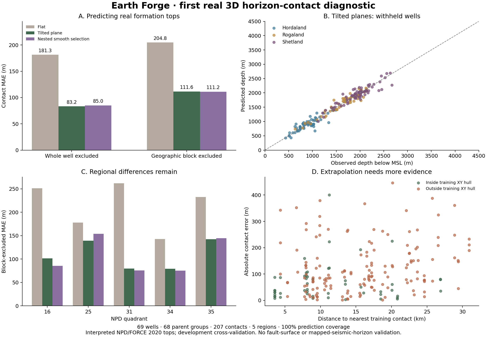

# Real 3D horizon contacts: first field geometry diagnostic

The new research workflow reconstructs major stratigraphic contacts from real
well data and evaluates them through the existing Rust 3D history engine.
**Tilted planes predict withheld contacts with 83.2 m well-excluded MAE and
111.6 m geographic-block-excluded MAE.** Every one of the 207 target contacts
is predicted. These are exploratory development results, not a SOTA claim.



[Vector figure](figures/field-geometry.svg) ·
[All results and intervals](../validation/field-geometry/results.json) ·
[Initial baseline](../validation/field-geometry/baseline-results.json) ·
[Frozen geometry plan](../validation/field-geometry/plan.json) ·
[Frozen improvement plan](../validation/field-geometry/improvement-plan.json)

## What the observations test

The supplied [FORCE 2020 v1 dataset](https://zenodo.org/records/4351156) includes
NPD-interpreted group-top coordinates. The benchmark uses 69 development wells
in 68 parent groups across quadrants 16, 25, 31, 34 and 35. These are every
preselected region with at least eight eligible parents sharing the three
scored major contacts: Hordaland, Rogaland and Shetland group tops. The Nordland
top supplies an additional cover boundary, giving 276 input picks including
the sea floor. These sparse major group contacts do not resolve thin beds.

Each contact uses its own supplied downhole XY and Z, including deviated wells.
Measured depth is not substituted for vertical depth. Coordinate origins are
translated into a recorded local Cartesian metre frame. No EPSG code or
horizontal geodetic datum is inferred, and external-coordinate data are not
mixed into this frame. Depth is `-Z` below mean sea level. Eligibility requires
the Nordland MD/Z pick to agree with the frozen official water-depth/RKB
reference within 2 m, using the earlier documented
[datum checks](force2020-development.md#depth-reference-and-quality-checks)
and [SODIR definitions](https://factpages.sodir.no/en/wellbore/Attributes).
Full downhole deviation surveys have not been independently reprocessed.

Of 94 development wells, 18 lie outside these regions, five lack an unambiguous
complete group-top sequence, one has no exact official metadata match and one
fails the depth-reference check. Observed MD and vertical depth must both
increase through the ordered picks. All exclusions and input hashes remain in
the report. The original 24-well holdout is still reserved. The workbook
contains its metadata, but those rows are skipped before coordinate extraction;
no holdout targets are scored and no log arrays or source LAS archive are opened.

These are correlated interpreted contacts, not independent survey truth.
They test **3D contact-depth reconstruction at real well locations**. They do
not independently validate mapped seismic horizon patches, fault surfaces,
fault topology, stresses, burial/pressure histories or the velocity law.

## Models and separation of training from evaluation

The new Python `Contact`, `fit_horizon_stack`, `predict_contacts` and
`select_horizon_stack` APIs fit geometry and construct an ordinary `History`.
The model uses four existing fill-to deposition operators, evaluated by the
same Rust core used in native and browser calculations. Compaction is disabled
because the fitted inputs already describe present geometry. Generic material
properties allow geometric evaluation; they are not a field-calibrated velocity
or lithology model. This reconstruction is not an inferred geological history.

Three alternatives are retained:

- Constant depth per horizon: an intentionally simple flat control.
- Independent affine XY planes: regional dip estimated from training contacts,
  with equal parent-well weights. Rank-deficient designs explicitly fall back
  to constants. This remains the default fitter.
- Experimental adaptive fitting: affine trends plus eight existing sine/cosine
  spatial terms, with five fixed smoothing strengths. Constants and planes are
  also candidates. Nested validation chooses one stack's complexity using only
  the outer training set, with no clipping or tuning after the trial outcomes.

The initial plan was committed at `06e40f0` before the first geometry scores.
The smoother's candidate family was committed at `232e095` after inspecting
the baseline residuals and before adaptive scores. All choices and outcomes
are therefore development evidence; this is not a newly untouched test cohort.

The two outer designs exclude either an entire parent well, including
sidetracks, or an entire NPD geographic block. Inner selection matches that
design. At least four training parents are required. No validation contact
depth enters a fitted field. All selected fields, inner candidate scores and
fold memberships are retained; the compact
[selection report](../validation/field-geometry/selection-results.json) records
every outer choice. Actual Rust horizon queries determine predictions. Missing,
repeated or out-of-domain contacts are failures; the code never picks an
occurrence by proximity to the observed answer.

## Results and the decision

| Reconstruction | Well-excluded MAE | Well-excluded RMSE | Block-excluded MAE | Block-excluded RMSE |
| --- | ---: | ---: | ---: | ---: |
| Flat control | 181.3 m | 230.4 m | 204.8 m | 257.4 m |
| **Tilted planes, default** | **83.2 m** | **112.7 m** | **111.6 m** | **146.4 m** |
| Nested smooth selection | 85.0 m | 122.3 m | 111.2 m | 152.1 m |

All methods have 100% target prediction coverage. Scores first average within
each parent, then give every parent equal weight. The general pipeline also
reports failures separately and a complete-cohort score with a declared
10,000 m missing-prediction penalty. No failure occurs here, so that penalty
does not affect these results. It is a comparison convention, not an accuracy
standard or measurement uncertainty.

Estimating dip reduces block-excluded error by 45.5% relative to the flat
control. This demonstrates the value of conditioning on regional observations;
it is not a comparison against GemPy, LoopStructural, Petrel or a SOTA method.
The stronger plane control is essential: the smooth trial's apparent block MAE
gain is only **0.4 m**, with a paired interval of **−8.3 to +9.6 m**, and its
well-excluded MAE and both RMSEs worsen. The smooth option stays experimental;
there is no evidence here for replacing the plane default.

The plane MAE intervals are 70.0–98.2 m for well exclusion and 94.8–128.6 m for
block exclusion. Intervals use 2,000 fixed-prediction parent resamples and omit
refitting, spatial dependence and interpretation uncertainty. They must not
be interpreted as calibrated geological uncertainty or a definitive significance
test. Regional bias and individual large errors remain in the complete report.

For block exclusion, 156 of 207 targets lie outside the training XY convex hull.
Plane MAE is 124.9 m there, versus 68.5 m on the 51 targets inside. The nearest
training-contact distance is also recorded. Extrapolation and regional
structure need more independent information; higher display resolution does
not remove those errors.

## Reproducibility and performance

The full adaptive run reproduces every prediction byte-for-byte on a second
run. All scores, bootstrap intervals and intake audits are identical, and the
initial flat/plane predictions remain unchanged. Full local outputs retain all
histories, inner predictions, coefficients and failures. Their fingerprints are
in the [repeat record](../validation/field-geometry/repeat-verification.json).
Two fixed field-fitted stacks also match native Rust exactly in all four
browser engines, for both continuous contacts and material points; see the
[engine parity record](../validation/field-geometry/engine-parity.json).
This checks shared numerical behavior, not additional observational accuracy.

The [performance record](../validation/field-geometry/performance.json) uses a
predetermined quadrant-35 outer plane fit with parent `35/11-1` withheld.
It has four prescribed surfaces, no faults, a 100 m material subdivision and
four native threads. One warmup and three fresh-process trials per task give:

| Task | Median native wall time | Separate caller JSON decode | Peak native RAM |
| --- | ---: | ---: | ---: |
| 1,764 continuous contact queries | 15 ms | 2 ms | 14 MiB |
| 49 × 49 × 241 block | 84 ms | 75 ms | 121 MiB |
| 501 × 501 section | 46 ms | 42 ms | 61 MiB |

Wall time includes native startup, input parsing, evaluation, serialization and
pipe transfer. These simple reconstructed surfaces are much cheaper than a
many-event faulted/compacting history. These timings establish neither general
real-time performance nor browser timing or power consumption. All trials,
sampling requests, source hashes and process-accounting measurements are kept.

The local checks cover analytical geometry through Rust, grouping, sidetrack
exclusion, support boundaries, singular fits, failed contacts, known smooth
surfaces, fixed-difference bootstrap and guards against opening log arrays.
The full Python research suite ran 39 tests: 38 passed and the optional
independent VTK reader test was skipped because VTK is not installed in the
field-study environment. All seven additional protocol tests passed. The
unchanged Rust engine is the same one used for the preceding alpha release;
this milestone adds geometry fitting/orchestration rather than new core physics.

## Reproduce

Use Python 3.12, the original prepared FORCE inputs and a fresh output directory:

```sh
python -m pip install -e ./python
python -m pip install -r validation/field-geometry/requirements.txt
cargo +1.88.0 build --locked --release
EARTHFORGE_ENGINE=target/release/earthforge python -m unittest discover -s python/tests -v
python -m unittest discover -s validation/field-geometry -p 'test_*.py' -v
python validation/field-geometry/run.py \
  --book /path/to/NPD_Lithostratigraphy_groups_all_wells.xlsx \
  --sodir /path/to/prepared/force2020/sodir-exploration.csv \
  --engine target/release/earthforge --adaptive --out /path/to/new/geometry-run
python validation/field-geometry/plot.py /path/to/new/geometry-run \
  --out /path/to/new/geometry-figure
node validation/field-geometry/verify-engines.mjs \
  /path/to/new/geometry-run /path/to/new/engine-parity.json
python validation/field-geometry/benchmark.py /path/to/new/geometry-run \
  --engine target/release/earthforge --out /path/to/new/performance.json
```

Wasm verification needs the four existing browser modules built first.
Peak process RAM measurement uses macOS/Linux process accounting. No raw
well-log arrays are redistributed by this milestone. The source dataset and
its interpretations retain their own provenance; project code remains MIT.

## What remains before broader 3D accuracy claims

1. Obtain mapped horizon patches and independent well/survey ties in a common,
   documented CRS/depth datum. Keep well targets and spatial patches out of
   fitting, and account for any well ties already used by the map interpreter.
2. Add independent fault traces/surfaces and stratigraphic correlations before
   fitting fault shapes, throws or kinematic history. Sparse major group tops
   alone cannot identify those quantities uniquely.
3. Test matched tasks against established structural modelers using the same
   data, exclusions, spatial splits and failure accounting. Retain accuracy,
   coverage, uncertainty and performance together.

The [F3 Demo description](https://terranubis.com/datainfo/F3-Demo-2023) supplies
mapped horizons and four wells, but its seismic horizons are in **time**;
independent time-depth ties and their uncertainty are required before scoring
depth errors. The [Volve release](https://www.equinor.com/energy/volve-data-sharing)
is another candidate for a depth-registered multiwell/fault case. No F3 or
Volve mapped horizon, independent fault surface or final FORCE holdout was
downloaded or scored in this milestone. Those are explicit remaining gates,
rather than claims implied by the real-well contact benchmark.
