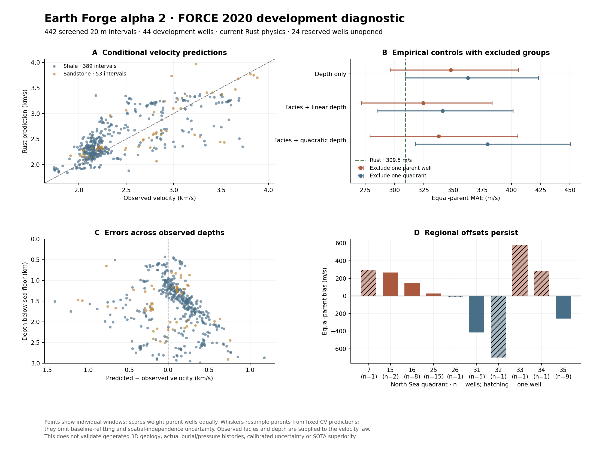

# Alpha 2: current Rust core against observed well logs

The current Rust velocity law has **309.5 m/s equal-parent MAE** on 442 screened
20 m intervals from 44 FORCE development wells. A facies-aware linear empirical
control has 324.6 m/s MAE when each prediction excludes its entire parent well.
The paired Rust-minus-control interval is **−51.9 to +21.7 m/s**; it does not
establish a clear advantage. The original 24-well holdout remains unopened.



[Vector figure](figures/field-validation-alpha2.svg) ·
[All scores and uncertainties](../validation/field-alpha2/results.json) ·
[Frozen plan](../validation/field-alpha2/plan.json) ·
[Input fingerprints](../validation/field-alpha2/input-manifest.json)

This is a conditional test with observed facies and depth supplied to the
velocity law. It does not test whether Earth Forge generates the correct real
3D basin, fault geometry, burial history or pore pressure. This development
cohort was examined in earlier work; the new run is not an independent final
test. No simulator coefficients or quality thresholds were changed.

## Inputs and controls

The inputs are the [FORCE 2020 version 1 logs and metadata](https://zenodo.org/records/4351156)
and the saved SODIR metadata snapshot. The publisher states that the logs were
partly cleaned/despiked and the lithology labels were interpreted. They are not
an untouched sonic-quality or mineral-fraction ground truth. Depth conversion
uses the [official reference definitions](https://factpages.sodir.no/en/wellbore/Attributes)
and the project's earlier documented sea-floor checks.

The frozen development membership, datum checks, maximum inclination, facies,
confidence, caliper screens and coverage rules are unchanged from the
[earlier protocol](../validation/force2020/protocol.md). The primary cohort has
389 shale and 53 sandstone intervals, with 8,782.6 m of observed vertical
support. It is selected for thick, consistently labelled clastic intervals;
it does not represent every lithology or every well in the source data.

The new pipeline reads 71 eligible development logs, including wells with no
accepted intervals. Membership/path checks and a process-wide audit hook reject
NPZ files outside the development directory, symlink escapes and log writes.
The results retain all exclusions, source hashes and the filenames read.

Every physical prediction calls the existing native Rust `physics` API.
Python supplies integration coordinates, quality screens and statistics; it
does not implement another velocity law. Primary assumptions are hydrostatic
pressure, brine, isotropy and maximum burial equal to present depth, with
shale/sandstone labels mapped to endmembers. The predefined burial, pressure
and facies sensitivities are retained separately; they are not fitted histories
for the observed wells. The current run reproduces all 442
earlier observation values exactly. Its full-bin Rust predictions differ from
the earlier TypeScript reference by at most **9.1 × 10⁻¹³ m/s**.

The additional support-matched calculation integrates model slowness only on
the accepted observed vertical segments, without filling gaps, using midpoint
spacing no larger than 1 m. It changes any prediction by at most 0.51 m/s and
changes overall MAE by only −0.007 m/s. Support mismatch is therefore small
on this cohort; it does not explain the approximately 309 m/s error.

## Results

The empirical controls use weighted least squares, giving each training parent
equal total weight. Separate shale/sandstone curves have either linear or
quadratic depth terms. There is no hyperparameter selection or clipping of
predictions. An absent training facies falls back explicitly to depth-only;
a singular design raises an error. Each held-out parent or quadrant is excluded
from fitting its own prediction.

| Predictor | Excluded fitting group | Bias, m/s | MAE, m/s | RMSE, m/s |
| --- | --- | ---: | ---: | ---: |
| Rust, matched support | No fitted coefficients in this run | −40.8 | 309.5 | 407.8 |
| Depth only | Parent well | +0.1 | 348.2 | 421.0 |
| Facies + linear depth | Parent well | −3.8 | 324.6 | 406.1 |
| Facies + quadratic depth | Parent well | −12.2 | 337.9 | 431.1 |
| Depth only | Quadrant | −4.5 | 362.8 | 436.4 |
| Facies + linear depth | Quadrant | −8.6 | 341.1 | 423.7 |
| Facies + quadratic depth | Quadrant | −8.7 | 379.6 | 472.7 |

All scores weight parent wells equally. RMSE is the square root of the mean
parent MSE. Rust's MAE interval is 249.2–378.6 m/s. Intervals resample parents
2,000 times from fixed predictions; they omit baseline-refitting and spatial
dependence uncertainty. They are not calibrated geological uncertainty bands.
The original holdout also has neighboring wells across partitions, so future
regional-generalization claims need a separate spatially blocked design.

The facies-aware linear control has slightly lower RMSE than Rust, despite
higher MAE. On sandstone alone, the depth-only well-excluded control has lower
MAE (323.4 m/s versus Rust's 326.2 m/s). All six controls, four quality variants,
predefined state sensitivities and depth/facies/quadrant breakdowns remain in
the report. None were discarded because of an unfavorable result.

Regional biases persist: the model is about 413 m/s too slow in quadrant 31
(five wells) and 256 m/s too slow in quadrant 35 (nine wells), but about 145 m/s
too fast in quadrant 16 (eight wells). These patterns motivate independent
burial, pressure, age and fluid constraints. They do not uniquely identify an
exhumation or pressure history. Several quadrants contain only one well.

## What follows

1. Expand development coverage to mixed and thin beds with independently
   justified facies-fraction ranges, preserving support, gaps and exclusions.
   A mixed lithology label must not silently become a measured sand fraction.
2. Attach independent burial/pressure/fluid evidence before testing revised
   histories. Fitting an error offset must not be presented as a measurement
   of uplift or pore pressure.
3. Validate geological conditioning on a compact, correlated multiwell case
   with surveyed coordinates, explicit formation mappings and withheld wells
   or horizon patches. Score contact-depth errors and velocity predictions
   separately, including incompatible models and coverage failures.

Two public sources are relevant for that next intake. The
[F3 Demo 2023 description](https://terranubis.com/datainfo/F3-Demo-2023)
lists seismic, four wells and interpreted horizons, in a seismic **time** domain.
It also identifies predicted density in two wells; those predictions cannot
serve as independent density targets. Depth conversion and interpretation
uncertainty must be explicit. The
[Equinor Volve release](https://www.equinor.com/energy/volve-data-sharing)
offers subsurface/operating data and geological models for a more contextual
case. No F3 or Volve data was downloaded, fitted or scored in this milestone.
Derived interpretations remain references with uncertainty, rather than an
unambiguous true geological model.

## Reproduce

Use a fresh output directory and the original prepared development inputs and
four metadata workbooks. Original arrays and metadata are read-only.

```sh
python -m pip install -r validation/field-alpha2/requirements.txt
python -m unittest discover -s validation/force2020 -p 'test_*.py' -v
python -m unittest discover -s validation/field-alpha2 -v
cargo +1.88.0 build --locked --release
python validation/field-alpha2/run.py \
  --data /path/to/prepared/force2020 \
  --downloads /path/to/original/workbooks \
  --engine target/release/earthforge \
  --out /path/to/new/field-run
python -m pip install -r validation/force2020/requirements-plot.txt
python validation/field-alpha2/plot.py /path/to/new/field-run \
  --out /path/to/new/figure
```

The 17 existing ingestion/comparison/context tests and nine new statistical,
support and access-guard tests pass. Local full outputs retain all predictions,
fold coefficients, intake audits and profiles. A repeat with the stricter frozen-metadata check reproduces every score,
interval and prediction CSV exactly. The compact public report
retains their scientific scope; no field-accuracy acceptance threshold or
SOTA superiority claim has been established.
