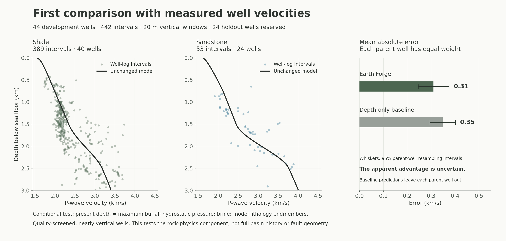

# First FORCE 2020 development comparison — 2026-10-12

**The unchanged rock-physics model has a well-balanced mean absolute error of
0.31 km/s on 442 screened, 20 m intervals from 44 development wells.** A simple
depth-only baseline scores 0.35 km/s. The apparent improvement is uncertain:
the paired resampling interval includes zero. No simulator coefficients were
tuned, and the 24 held-out wells have not been scored.

This is a conditional test of the velocity calculation used by the simulator.
It supplies observed lithology and depth to that function. It does not test
whether a generated basin reproduces real stratigraphy, faults, erosion or
burial history. The lithology classes are interpreted labels, not independent
mineral-fraction measurements.



[Download the vector figure](figures/force2020-development.svg).

A subsequent [material-state repair and development rerun](material-state-development.md)
preserves this original result and its artifacts. That rerun corrects the uplift-scenario
plumbing and pressure assumptions; the primary hydrostatic score is unchanged.

## Depth reference and quality checks

The original LAS `Z_LOC` unit is unspecified. To establish its reference for
this comparison, we checked both the supplied Nordland top MD and Z against
the official sea-floor reference for each development well:

- `top MD ≈ water depth + RKB elevation`;
- `top Z ≈ −water depth`;
- LAS Z agrees with at least three companion coordinate picks, with no tie
  error above 1 m.

The [SODIR attribute definitions](https://factpages.sodir.no/en/wellbore/Attributes)
identify water depth and RKB elevation relative to mean sea level. A concrete
example is [15/9-13](https://factpages.sodir.no/en/wellbore/pageview/exploration/all/45):
81 m water depth and 25 m RKB elevation correspond to the supplied sea-floor
pick at MD 106 m and Z −81 m. Thus depth below sea floor is **−Z − water depth**;
subtracting RKB again would introduce an error.

Using a 2 m datum tolerance, **92 of 94 development wells have supported depth
references**. `16/11-1 ST3` lacks an exact official-name match. `34/10-16 R` has
a 3 m difference between the supplied sea-floor pick and the current official
reference. Both are excluded, without altering their data or partition.
The surviving references support this conversion; the complete downhole
deviation surveys have not been independently reprocessed.

Of those 92 wells, 71 have reported maximum inclination of 15° or less. The
primary screen then requires:

- a single sandstone or shale class throughout the known part of each 20 m
  window, with confidence 1 for every contributing sonic sample;
- positive finite sonic values and caliper/bit-size measurements differing
  by at most 1 inch;
- at least 18 m of observed vertical support per window, with no internal
  quality gap larger than 1 m; no extrapolation, imputation or velocity clipping.

Caliper is a [qualitative indicator of borehole condition](https://glossary.slb.com/terms/c/caliper_log).
The 1 inch threshold is a preselected project screen, **not a published accuracy
standard or a certificate that the sonic waveform is good**. Density corrections
and original acoustic waveforms would be additional quality evidence. The
released FORCE curves were already partly cleaned/despiked by the provider.

The resulting cohort covers 8,783 m of observed vertical support: 389 shale
windows and 53 sandstone windows. It contains 44 wells, with 1–36 windows per
well (median 7). One constant-sonic window is retained and flagged. No accepted
window falls outside the model's velocity cap; source values outside that cap
were not removed by an acceptance filter.

Of the 10,650 potential windows in the 71 nearly vertical wells, 1,802 lack
coordinate coverage, 6,891 have mixed or absent labels, 322 contain other facies,
1,175 lack sufficient quality-screened coverage, and 18 have internal gaps.
These exclusions make this a selected cohort of relatively thick, consistently
labelled intervals. It is not representative of every bed in the dataset.

## Comparison method

The [analysis plan](../validation/force2020/benchmark-plan.json) was saved before
inspecting model errors. Observed velocities are averaged through **slowness**,
weighted by their vertical sample support. This preserves travel time over the
observed part of a window; it is not the arithmetic mean of velocities.

The Node exporter calls the actual `rockVelocity` function from `src/basin.ts`;
there is no Python reimplementation. Model windows use 1 m midpoint quadrature
over their 20 m thickness. The primary assumptions are hydrostatic pressure,
brine, isotropy, present depth equal to maximum burial, and model endmembers
`f=0` for shale and `f=1` for sandstone. These are test conditions, not measured
fluid states or burial histories for every well.

The baseline is a straight-line velocity/depth fit. Each prediction excludes
its entire parent well from fitting, and each training parent has equal total
weight. This is grouped leave-one-out cross-validation within development.
The simulator uses facies information; the intentionally simple baseline does
not. The primary result should therefore not be interpreted as a comparison
against the strongest empirical predictor.

Errors below give equal weight to each parent well. RMSE is the square root
of the mean per-parent mean-squared error. Uncertainty uses 2,000 paired
parent-well resamples. It describes this selected cohort and the stored
cross-validated predictions; it does not include all measurement, model,
spatial-dependence or baseline-refitting uncertainty.

| Predictor | Bias, km/s | MAE, km/s | RMSE, km/s |
| --- | ---: | ---: | ---: |
| Unchanged model, primary assumptions | −0.041 | 0.309 | 0.408 |
| Depth-only baseline, out-of-parent predictions | +0.000 | 0.348 | 0.421 |

Bias is predicted minus observed; negative means too slow. The model MAE's 95%
parent-resampling interval is **0.246–0.375 km/s**. The paired model-minus-baseline
MAE difference is **−0.039 km/s**, with interval **−0.083 to +0.001 km/s**.
That interval does not establish a clear advantage over the baseline.

| Depth below sea floor | Windows / wells | Model bias, km/s | Model MAE, km/s | Baseline MAE, km/s |
| --- | ---: | ---: | ---: | ---: |
| 0–1 km | 55 / 14 | −0.072 | 0.149 | 0.186 |
| 1–2 km | 277 / 32 | −0.053 | 0.291 | 0.353 |
| 2–3 km | 110 / 25 | +0.116 | 0.313 | 0.353 |

Shale MAE is 0.302 km/s; sandstone MAE is 0.326 km/s. The depth-only baseline
slightly outperforms the model on sandstone MAE (0.323 km/s). The small overall
signed bias conceals substantial errors in individual wells.

## Sensitivity and practical conclusion

The predefined quality screens give:

| Caliper difference allowed | Windows / wells | Model MAE, km/s |
| --- | ---: | ---: |
| 0.5 inch | 228 / 38 | 0.318 |
| 1 inch, primary | 442 / 44 | 0.309 |
| 2 inches | 602 / 44 | 0.310 |
| Include missing/flagged caliper quality | 1,324 / 63 | 0.263 |

These screens change the sampled population. The lower error in the last row
does not show that poorer-quality data are preferable; it shows why coverage
and selection must accompany the score.

On the same primary cohort, globally adding 500 m or 1,000 m to maximum burial
raises MAE to 0.423 or 0.706 km/s. The predefined overpressure-below-1.5-km
scenario gives 0.363 km/s; less-pure endmembers (`f=0.2/0.8`) give 0.324 km/s.
These are sensitivity runs, not fitted alternatives or measurements of those
properties. They do not justify assigning one pressure or erosion history to
all wells.

The present velocity law captures a useful broad depth trend, but its empirical
accuracy is limited and variable. The next useful work is to expand coverage
to mixed/thin beds and attach formation, fluid and burial context before testing
changes to the pressure and cementation assumptions. Acceptance limits still
need an intended-use and measurement-uncertainty basis. The holdout remains
reserved for the final, fixed protocol.

## Reproduce and verify

The original five downloads and saved SODIR CSV are used as read-only inputs.
See [the intake protocol](../validation/force2020/protocol.md) for environment
setup, sources and the fixed split.

```sh
python -m unittest discover -s validation/force2020 -p 'test_*.py' -v
node validation/force2020/model-profiles.mjs
python validation/force2020/compare.py --downloads /path/to/original/downloads
python -m pip install -r validation/force2020/requirements-plot.txt
python validation/force2020/plot_comparison.py
```

[Machine-readable results](../validation/force2020/development-results.json)
include scenario scores, coverage, source hashes and exclusions. Local
`data/force2020/comparison/` contains the 442 individual windows, full per-well
depth evidence, prepared-file hashes and complete audit. No held-out array is
opened by the comparison loader.

Verification: **12 ingestion/comparison tests and 12 existing simulator tests
pass**. Tests independently exercise unit conversions, missing data, wrong depth
references, slowness-weighted averaging, gaps, mixed windows, whole-group baseline
exclusion, equal-parent metrics and holdout separation. The simulator source and
its physical coefficients remain unchanged.
